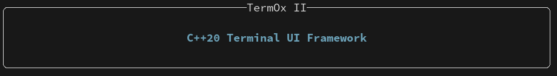
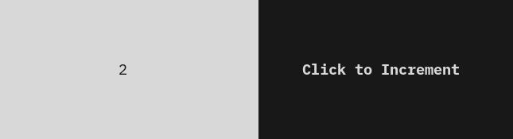
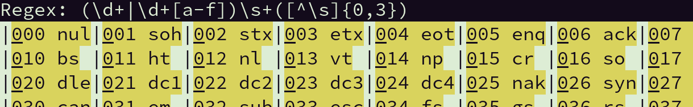
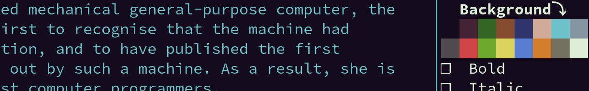
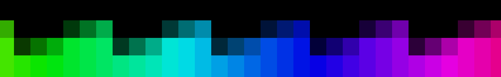
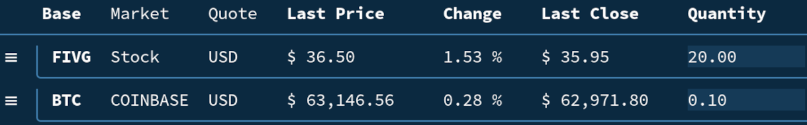
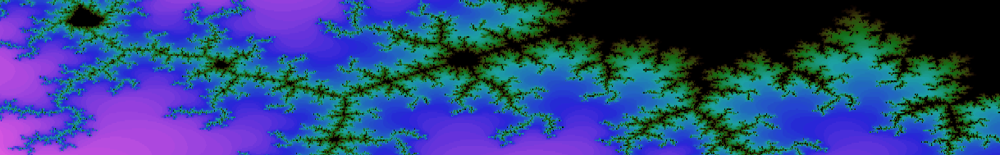

# TermOx II 🐂🐂

**TermOx** is a C++20 library for creating rich, interactive terminal user interfaces 
with minimal code.

- [📚 Getting Started](docs/getting_started.md)
- [📖 Reference](docs/reference.md)
- [💻 Examples](examples)

## Quick Example

<p align="center">
  
</p>

```cpp
#include <ox/ox.hpp>
using namespace ox;

int main()
{
    auto head = Label{{
                    .text  = "C++20 Terminal UI Framework",
                    .align = Align::Center,
                    .style = {.foreground = colors::blue, .traits = Trait::Bold},
                }} | Border{.box = shape::Box::round(), .label = "TermOx II"};

    return Application{head}.run();
}
```

📂 Explore more in the [examples](examples) directory.

Use [scratch.cpp](examples/scratch.cpp) and the `TermOx.examples.scratch` build target
to try out the library quickly.

## Features

### Core Capabilities
- **Flexible Layout System** - Size policies and automatic sizing
- **Event-Driven Architecture** - Clean handling of user input and system events
- **Signal/Slot System** - Based on [Signals Light](https://github.com/a-n-t-h-o-n-y/signals-light)
- **Timer Support** - Periodic actions with timer events
- **Custom Widgets** - Create your own widgets with ease

### Rich Terminal Styling
- **Colors** - Full RGB, HSL, and [XTerm 256 Color](https://jonasjacek.github.io/colors/) support
- **Text Styling** - Bold, italic, underline, strikethrough, and more
- **Unicode Support** - Validated UTF-8 text, complete graphemes, and wide-cell drawing

### Input Handling
- **Keyboard** - Press, repeat, and release events, modifiers, and special keys
- **Mouse** - Click, scroll, movement, and enter/leave events
- **Focus Management** - Tab navigation, mouse click, and focus events

### Widget Library
- **Core Widgets** - Labels, buttons, text inputs, checkboxes, radio buttons, data
tables and more
- **Layout Widgets** - Horizontal, vertical, and suspended layouts

## Build Instructions

**TermOx** uses [CMake](https://cmake.org/) to generate build targets.

    git clone https://github.com/a-n-t-h-o-n-y/TermOx.git
    mkdir TermOx/build && cd TermOx/build
    cmake ..
    make TermOx

Dependencies ([Signals Light](https://github.com/a-n-t-h-o-n-y/signals-light),
[zzz](https://github.com/a-n-t-h-o-n-y/zzz), and
[Escape](https://github.com/a-n-t-h-o-n-y/Escape)) are automatically fetched by CMake.

## Escape API Migration

TermOx uses Escape's session API, `Style`, `RGB`, `IndexedColor`, and typed input
events. Widget handlers receive `KeyEvent` and the corresponding mouse event type.
Pass `Terminal::Options` to `run()`, for example
`Application{head}.run({.mouse_mode = MouseMode::Move})`. Ctrl-C exits through the event
loop by default, and the session restores terminal state on exit.

Text inputs accept Unicode key text and bracketed paste. Frames store complete
graphemes with explicit continuation cells, and clipped canvases use Escape's width
estimates. See [frames and canvases](docs/frame-and-canvas.md) for drawing and resize contracts,
[rendering](docs/renderer.md) for frame comparison and terminal output,
and [layout calculation](docs/layout.md) for sizing and placement.
A C++20 compiler and standard library are required.

Build and run the regression tests with:

```sh
cmake --build build --target TermOx.tests.unit
ctest --test-dir build --output-on-failure
```

On macOS or Linux, check interactive input and terminal restoration with:

```sh
cmake --build build --target TermOx.tests.renderer_terminal \
    TermOx.examples.pong TermOx.examples.pinbox \
    TermOx.examples.snake TermOx.examples.accumulator TermOx.examples.scratch
python3 tests/smoke_examples.py build
```

## Application Core

The application owns its event loop and focus. Timers share the loop's steady-clock
scheduler. Input, callbacks, and rendering run on one thread, with explicit repaint
requests and one paint per batch. Constructing an application does not open a terminal;
`step()` and `paint()` can be tested independently. See [the event loop guide](docs/event-loop.md)
for headless dispatch, posting background work, and lower-level composition.

## Note on Version 2

Version 2 is a complete rewrite of the library. It focuses on providing a simpler set of
base widgets and a light-weight core implementation of events processing and rendering.
As such, the API has little in common with the previous version.

## A Second Example

<p align="center">
  
</p>

```cpp
#include <ox/ox.hpp>
using namespace ox;

// Counter Button + Label
int main()
{
    auto counter = Row{
        IntegerLabel{{
            .value = 0,
            .align = Align::Center,
            .style = {.background = colors::white, .foreground = colors::black},
        }},
        Button{{
            .text = "Click to Increment",
            .align = Align::Center,
            .style = {.background = colors::black,
                      .foreground = colors::white,
                      .traits = Trait::Bold},
            .press_mod = [](Label& l) { l.style.foreground = colors::yellow; },
        }},
    };

    auto& [label, button] = counter.children;

    // Signals and Slots
    Connection{
        .signal = button.on_press,
        .slot = [](IntegerLabel& l) { ++l.value; },
    }(label);

    return Application{counter}.run();
}
```

## Gallery

<p align="center">
  
</p>
<p align="center">
  
</p>
<p align="center">
  
</p>
<p align="center">
  
</p>
<p align="center">
  
</p>
<p align="center">
  
</p>

## Contributing

Contributions are welcome! Please feel free to submit a Pull Request.

## License

This project is licensed under the MIT License - see the [LICENSE](LICENSE) file for
details.
