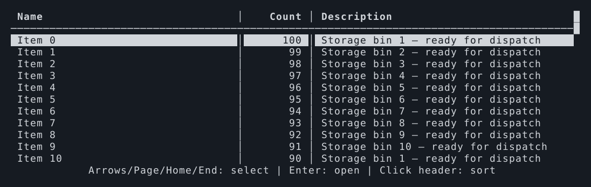

# TermOx III 🐂🐂🐂

TermOx is a C++20 library for terminal user interfaces. Compose widgets with rows
and columns, connect their signals, and run the application. It includes text
editors, tables, trees, menus, and custom drawing, with keyboard and mouse input.



## A counter

Click **Increment**, or press Tab to focus the button and Enter to activate it.
Ctrl-C exits.

```cpp
#include <ox/ox.hpp>

using namespace ox;

int main()
{
    auto root = Column{
        IntegerLabel{{.value = 0}},
        Button{{.label = {.text = "Increment"}}},
    };
    auto& [count, button] = root.children;
    Connection{
        .signal = button.on_activate,
        .slot = [](IntegerLabel& count) { count.set_value(count.value + 1); },
    }(count);

    return Application{root}.run();
}
```

The layout owns the widgets. The connection passes the live label to the callback;
`set_value()` updates it and requests a repaint.

## Build and run

You need Git, CMake 3.18 or newer, and a C++20 compiler and standard library with
`std::format` support. CMake fetches the dependencies on the first configure.

```sh
git clone https://github.com/a-n-t-h-o-n-y/TermOx.git
cd TermOx
cmake -S . -B build -DCMAKE_BUILD_TYPE=Release
cmake --build build --target TermOx.examples.counter
./build/examples/TermOx.examples.counter
```

See [Getting Started](docs/getting_started.md) for build details and using TermOx
in your own project.

## Documentation

- [Guides](docs/README.md): layout, input, styling, custom widgets, and internals.
- [API reference](docs/reference.md): interfaces and their headers.
- [Examples](examples/README.md): runnable programs, build targets, and walkthroughs.
- [Table walkthrough](examples/datatable.md): sorting, scrolling, and responding to selection.

Version 3 changes the widget API, event processing, layout, and rendering. Existing
applications should check the migration sections in the [widget API](docs/widget-api.md),
[containers and decorations](docs/decorations-layouts.md), and
[text editing](docs/text-editing.md) guides.

Contributions are welcome. TermOx is released under the [MIT license](LICENSE).
