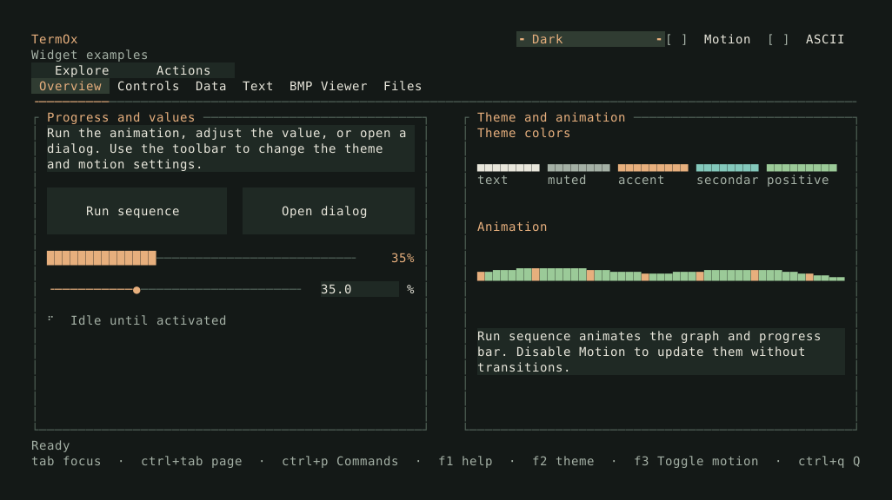

# TermOx III 🐂🐂🐂

TermOx is a C++20 library for terminal user interfaces. It includes layouts, text
editors, tables, trees, menus, and custom drawing, with keyboard and mouse input.

[](examples/showcase.md)

## A counter

```cpp
#include <ox/ox.hpp>

using namespace ox;

int main()
{
    auto root = Column{
        IntegerLabel{{.value = 0}},
        Button{{.label = {.text = "Increment"}}},
    };
    auto& [count, button] = root.children;
    Connection{
        .signal = button.on_activate,
        .slot = [](IntegerLabel& count) { count.set_value(count.value + 1); },
    }(count);

    return Application{root}.run();
}
```

## Build and run the showcase

You need Git, CMake 3.18 or newer, and a C++20 compiler and standard library with
`std::format` and coroutine support. CMake fetches the dependencies on the first configure.

```sh
git clone https://github.com/a-n-t-h-o-n-y/TermOx.git
cd TermOx
cmake -S . -B build -DCMAKE_BUILD_TYPE=Release
cmake --build build --target TermOx.examples.showcase
./build/examples/TermOx.examples.showcase
```

Ctrl-C exits.

## Documentation

- [Getting Started](docs/getting_started.md): create, build, and run your own project.
- [Guides](docs/README.md): scrolling, forms, background work, layout, and drawing.
- [API reference](https://a-n-t-h-o-n-y.github.io/TermOx/): methods, options, and signals.
- [Apps](examples/README.md): source files, build targets, and walkthroughs.
- [Internals](docs/internals/README.md): layout calculation, routing, frames, and rendering.

See [Contributing](docs/contributing.md) for build and test instructions.
TermOx is released under the [MIT license](LICENSE).
