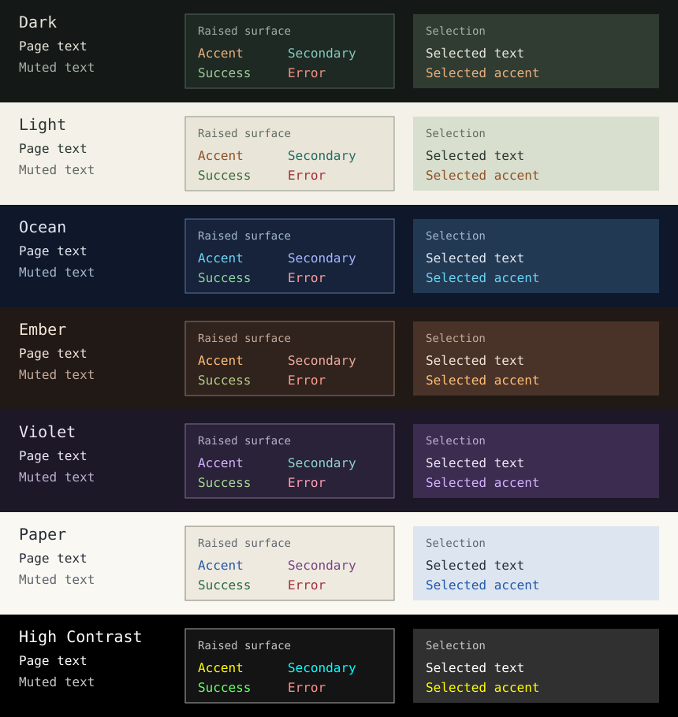

# Theme and motion

TermOx can apply one visual policy to the entire widget tree:

```cpp
auto app = ox::Application{root};
auto theme = ox::Theme::dark();
theme.motion.frames_per_second = 60;
app.set_theme(theme);
return app.run({.mouse_mode = ox::MouseMode::Move});
```

`Theme::plain()` is the default. Choose a preset to apply colors and styling
throughout the application.

The styled themes use open-ended focus marks, a moving tab underline, restrained
selection backgrounds, generous button insets, and fractional progress fills.
Widget values, selection, focus, and input remain immediate. Motion affects
presentation; tab contents change immediately while the underline moves.

## On this page

- [Presets](#presets)
- [Colors and overrides](#colors-and-overrides)
- [Motion](#motion)
- [Lines and endpoints](#lines-and-endpoints)
- [Keyboard help](#keyboard-help)
- [Showcase](#showcase)

## Presets

| Factory | Appearance |
| --- | --- |
| `Theme::dark()` | Graphite green surfaces, copper and teal accents |
| `Theme::light()` | Warm light surfaces, copper and teal accents |
| `Theme::ocean()` | Deep blue surfaces, cyan and periwinkle accents |
| `Theme::ember()` | Warm charcoal surfaces, amber and rose accents |
| `Theme::violet()` | Aubergine surfaces, lavender and mint accents |
| `Theme::paper()` | Ivory surfaces, dark ink and blue accents |
| `Theme::high_contrast()` | Black surfaces, white text, yellow accents and bright borders |
| `Theme::terminal()` | Terminal palette colors and ASCII decorations |
| `Theme::plain()` | Unstyled drawing with explicit widget colors |



Terminal uses the terminal's configured colors, so its appearance varies. Plain
leaves styling to the application. Neither has a fixed palette preview.

The RGB presets share the same widget styling and motion defaults. Each defines
all ten palette roles; colors can be changed individually:

```cpp
auto theme = ox::Theme::ocean();
theme.palette.accent = ox::RGB{0xffcc88};
app.set_theme(theme);
```

## Colors and overrides

`theme.palette` exposes `background`, `surface`, `foreground`, `muted`, `accent`,
`secondary`, `positive`, `negative`, `border`, and `selection`. Customize these
roles and call `set_theme()` again. Theme changes repaint and recalculate layout,
including widgets attached later or shown on another page.

Explicit widget foreground/background colors take precedence over theme defaults.
Custom state patches still apply after the theme's state styling. For custom
widgets, use `appearance(style, Surface::Raised)` or another semantic role;
`selection_appearance(style, selected_style)` applies selection consistently.
Dropdowns and menus use the raised surface color to distinguish them from the
page background. Lists expose a `role` option for choosing their surface.
Plain `Canvas` drawing remains explicit.

Labels accept a role without needing a color:

```cpp
auto heading = ox::Label{{.text = "Settings", .role = ox::Surface::Accent}};
auto detail = ox::Label{{.text = "Saved locally", .role = ox::Surface::Muted}};
```

Set `theme.ascii = true` for ASCII borders, tab indicators, focus markers,
scrollbar thumbs, sliders, meters, spinner, and keyboard-help symbols. This does not
transliterate application text or pixel graphics. RGB themes depend on the
terminal's color support; select `Theme::terminal()` when palette colors are
preferred. TermOx does not guess a user's font or terminal capabilities.

## Motion

`theme.motion.enabled = false` makes transitions immediate and stops themed
spinner timers. This does not disable application timers: background work and
model updates continue. There is no automatic operating-system preference lookup;
applications can expose a switch, as the showcase does.

The policy provides `feedback` (120 ms), `selection` (240 ms), and `progress`
(240 ms) durations, plus a shared frame-rate limit (60 by default; 1–240 allowed).
Zero durations settle immediately. Buttons, tabs, progress bars, and scrollbar
settling share the event loop's frame clock. Idle transitions schedule no wakes.
Dragging scrollbars and editing values remain direct.

Custom widgets can bind presentation to their lifetime:

```cpp
class Indicator : public ox::Widget {
    ox::Animation amount_{*this};
public:
    void show(double value) {
        amount_.to(value, {theme().motion.feedback, ox::Ease::OutCubic});
    }
    auto paint(ox::Canvas canvas) -> ox::Cursor override {
        ox::paint_meter(canvas, amount_.value(),
                        appearance({}, ox::Surface::Accent),
                        appearance({}, ox::Surface::Border));
        return {};
    }
};
```

Retain the `Animation` as a member. It follows widget moves, requests repaint,
respects reduced motion, and unregisters when destroyed. Hidden subtrees do not
schedule frames; reattachment catches up using elapsed time. Disabled widgets
settle without animation. `on_frame()` can return additional effects; capture a
tracked widget when a callback refers to widget storage. Frame callbacks run on
the application thread, and only when the sampled value changes. Immediate
transitions do not invoke frame callbacks; model changes belong in the command
that starts the transition.

`Tween` provides the same elapsed-time interpolation without a widget or scheduler.
`Linear`, `OutCubic`, `InOutCubic`, and `Spring` are available. `Spring` is a
normalized critically damped curve with a finite duration and no overshoot.
Retargeting samples the current position before starting the next transition.

## Lines and endpoints

Styled widgets use capped box-drawing rules with a consistent stroke weight.
Tab underlines and scrollbar thumbs advance in whole-cell steps. Active and
inactive portions differ by color; no glyph spans the two colors.
Dividers, menu separators, and progress tracks have directional endpoints; table column rules connect to the
header separator with junctions rather than being overwritten by it. Tree views
use branch junctions and continuation lines that follow expansion and scrolling;
the connectors preserve each row's selection background.

`paint_rule()` exposes the same drawing for custom widgets:

```cpp
ox::paint_rule(canvas, 2.5, 8.0,
               appearance({}, ox::Surface::Accent),
               appearance({}, ox::Surface::Border));
```

Start and length are in cell units along the first row, or the first column with
`vertical = true`. A zero length draws only the track. Start and length are rounded
to whole cells. Coordinates can extend outside the canvas and are clipped without shifting the rule's geometry.
Nonfinite coordinates, negative lengths, and overflowing endpoints are rejected.
`ascii = true` uses ordinary ASCII strokes instead. Custom dashed, dotted, double,
and box presets retain their configured glyphs.

Progress fills use eighth-cell block characters. An almost-empty partial
cell shows the track, and vertical meters use vertical
strokes. A partly filled block and a thin track cannot occupy the same cell as
separate glyphs; their appearance also depends on the terminal font.

## Keyboard help

`KeyHelp` displays and dispatches shared `Command` definitions. Its actions are
scoped through normal widget shortcut routing. Empty actions are help-only.
Only press events trigger actions; disabled commands are omitted.

```cpp
auto theme = ox::command({.text="theme", .action=[&] {
    app.set_theme(ox::Theme::light()); return ox::EventResponse{};
}, .keys={{ox::KeyCode::F2, {}}}});
auto help = ox::KeyHelp{{theme}};
```

Include the help widget in the tree. `expanded=true` enables wrapped help;
call `refresh()` after changing commands or the expanded flag. `key_label()`,
`command_keys()`, and `dispatch_commands()` are independent functions.
See [shared commands](commands.md).

## Showcase

Build and run from the repository root:

```sh
cmake -S . -B build
cmake --build build --target TermOx.examples.showcase
./build/examples/TermOx.examples.showcase
./build/examples/TermOx.examples.showcase --theme ocean
```

The six pages cover animation and values; a validated form and selection controls;
filterable lists, tables, trees, logs, and split panes; Unicode text editing and
labels; pixel graphics; and file picking. Menus, a command palette, dialogs,
keyboard help, linked scrollbars, and responsive layouts connect the pages.

Use Tab for focus, Ctrl+Tab to change pages, Ctrl+P for commands, F1 for expanded
help, F2 to cycle themes, F3 for motion, and Ctrl+C to exit. Choose a theme from
the toolbar, the Actions → Theme menu, or the command palette. Selecting a preset
also selects its ASCII setting; the toolbar's ASCII checkbox can override it.
Motion has its own checkbox. The example offers deterministic headless checks:

```sh
./build/examples/TermOx.examples.showcase --check
./build/examples/TermOx.examples.showcase --dump --page 2 --width 120 --height 38
./build/examples/TermOx.examples.showcase --json --light
```

On POSIX systems, run `python3 -B tests/smoke_showcase.py build` to exercise input,
resizing, overlays, and terminal restoration through a pseudo-terminal.

`--theme` accepts `dark`, `light`, `terminal`, `ocean`, `ember`, `violet`, `paper`,
and `high-contrast`. `--light` and `--terminal` are shortcuts for those presets.
`--page` accepts 0–5. Dumps disable motion
and print actual frame contents; JSON includes each cell's text, width, and RGB
colors when present. `--check` exercises every page in every selectable theme at
large, narrow, tiny, and zero sizes, plus validation, filtering, and overlays.
