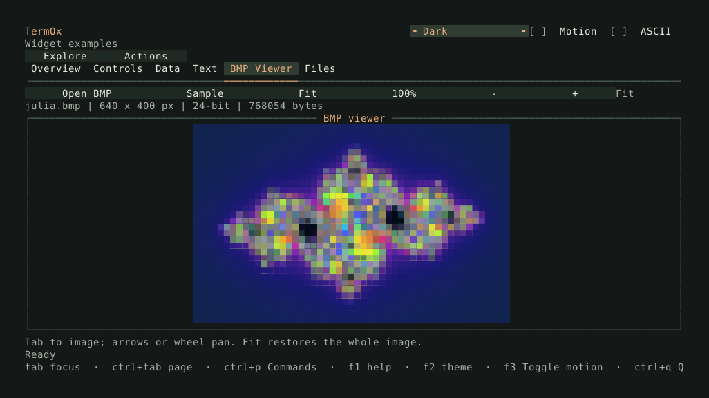

# BMP viewer in Showcase



Build and open the image page:

```sh
cmake --build build --target TermOx.examples.showcase
./build/examples/TermOx.examples.showcase --page 4
```

The viewer starts with `assets/julia.bmp`, a bundled 640 × 400 Julia fractal.
CMake copies it into the build directory and supplies its path to the program,
so the viewer works when launched from another working directory. The artwork
is original procedural output covered by the repository's MIT license. Regenerate
it with `python3 examples/assets/generate_fractal.py`.

## Controls

- **Open BMP** opens a file browser. Navigate directories or enter a path in its
  location field. Select a BMP, then choose it. Cancel or Escape returns to the image.
- **Sample** reloads the bundled image and restores Fit.
- **Fit** displays the whole image, preserving its proportions and centering it.
  Resizing the terminal recalculates the fit.
- **100%** displays one source pixel per terminal column and two pixel rows per
  terminal row.
- **− / +** halve or double the current scale, between 1% and 800%. Zoom keeps the
  center of the viewport in view, subject to the image edges.
- Focus the image with Tab, then use the arrow keys to pan. The mouse wheel also
  pans while over the image. Fit returns to the whole image.

The information line shows the filename, source dimensions, bit depth, and file
size. The zoom indicator shows Fit or the current percentage. Ctrl+P offers
**BMP viewer** and **Open BMP** commands.

## How it works

[showcase.cpp](showcase.cpp) composes the buttons, metadata labels, image viewport,
and a modal `FilePicker`. Button callbacks change the view and refresh the labels.
The picker filters filenames to `.bmp`, case-insensitively; directories remain
available for navigation. File contents are validated independently of their extension.

[bmp_reader.hpp](bmp_reader.hpp) decodes supported BMP formats into an owned RGB
array. [bmp_image.hpp](bmp_image.hpp) retains that source array and calculates each
visible terminal cell from the current scale and pan offset. A lower-half block
holds two pixel colors. Shrinking averages samples across each source footprint;
at 100% and above, nearest-neighbor sampling keeps source pixels distinct. Zoom
never allocates a second, enlarged image. Empty and clipped viewports paint safely.

Loading decodes into temporary storage before replacing the current image. Errors
appear in the file dialog, leaving the previous image available. This example
limits files to 32 MiB and images to 16 megapixels to bound synchronous loading and
memory use. The decoder supports 1-, 4-, 8-, 16-, 24-, and 32-bit BMPs with
uncompressed pixels or supported 16-/32-bit color masks; compressed BMPs are rejected.

See [Pixel images](../docs/drawing.md#pixel-images) for pixel drawing
and [file selection](../docs/file-picker.md) for browser
behavior.
