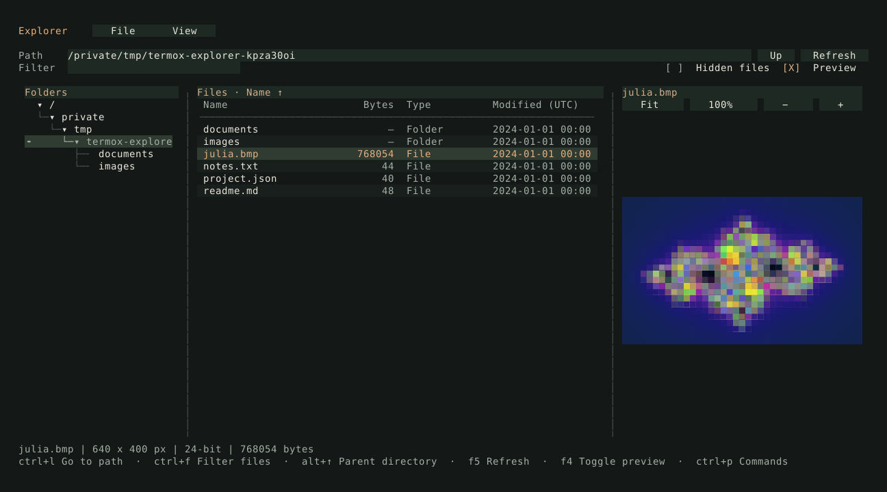

# Explorer

A file browser with a directory tree, sortable file table, and text/BMP previews.
It reads files without modifying them.



```sh
cmake -S . -B build -DCMAKE_BUILD_TYPE=Release
cmake --build build --target TermOx.examples.explorer
./build/examples/TermOx.examples.explorer
./build/examples/TermOx.examples.explorer examples/assets
```

The default directory is the working directory. Select a folder and press Enter to
open it; the tree also supports double-clicking. It shows the current directory's ancestors and immediate
subdirectories; opening a folder loads its children. Selecting a file previews it.
Click a table heading to sort; folders stay first. Filtering matches name substrings,
ignoring ASCII case. Hidden files are omitted until enabled.

## Controls

| Key | Action |
| --- | --- |
| Tab / Shift-Tab | Move focus |
| Enter | Open the selected folder |
| Alt-Up | Parent directory |
| Ctrl-L | Edit the directory path; Enter opens it |
| Ctrl-F | Filter file names |
| F5 | Refresh the directory |
| F4 | Toggle the preview pane |
| Ctrl-P | Search commands |
| F10 | Focus the menu bar |
| Ctrl-C | Exit |

Drag the pane dividers to resize them. The View menu controls hidden files,
previews, and dark/light/terminal themes. Text previews support selection, copying,
and scrolling. For BMPs, use Fit, 100%, −, and +; focus the image to pan with arrows
or use the mouse wheel. Fit follows resizing and preserves image proportions.

## Files and previews

Text previews read up to 256 KiB of UTF-8. Binary data and unsupported control
characters produce a message instead of being sent to the terminal. BMP previews
accept files up to 32 MiB and images up to 16 megapixels. The bundled
[Julia fractal](assets/julia.bmp) is procedural artwork under the repository's MIT
license; regenerate it with `python3 examples/assets/generate_fractal.py`.

Directory scans stop at 10,000 entries and display a notice when limited. Unreadable
entries remain listed with unavailable metadata. Failed navigation keeps the current
directory. Names that cannot be displayed as terminal text are escaped; selecting
those rows still uses the original filesystem paths. Modified times use UTC.

Scans and preview reads run on one worker. New requests replace queued work, and
stale results are discarded. Cancellation is checked between filesystem operations;
a blocked filesystem call can delay the next request or shutdown.

## Implementation and checks

[explorer.cpp](explorer.cpp) composes built-in widgets and connects their actions.
[explorer_model.hpp](explorer_model.hpp) handles scanning, sorting, bounded previews,
and the worker. [bmp_image.hpp](bmp_image.hpp) draws the image preview using the
shared [BMP decoder](bmp_reader.hpp).

```sh
cmake --build build --target TermOx.tests.explorer
ctest --test-dir build -R '^TermOx.tests.explorer$' --output-on-failure
python3 tests/smoke_explorer.py build
```

The Python checks use temporary files and a POSIX pseudo-terminal. They cover
navigation, filtering, sorting, stale results, previews, errors, resizing, and terminal
restoration. Headless frame exports are also available:

```sh
./build/examples/TermOx.examples.explorer examples/assets --json --select julia.bmp
./build/examples/TermOx.examples.explorer --dump --width 100 --height 30
```

`--theme` accepts `dark`, `light`, or `terminal`; `--filter` and `--select` set the
initial filter and selected filename. `--check` exercises navigation and layout
against the supplied directory without opening a terminal.
